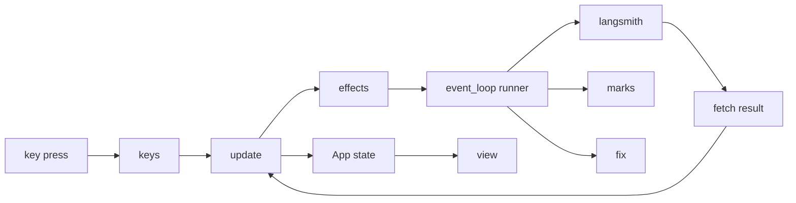

# Architecture

`traces` is one binary: a TUI (`traces`) and three commands (`traces marks`, `traces fix`, `traces url`).
`src/lib.rs` holds everything and `src/main.rs` parses the command line and calls `run`.
This page says how the code is laid out today.
When a boundary or a flow changes, change this page in the same MR.

## Module map

| Module | What it holds |
|---|---|
| `main.rs`, `cli.rs` | The clap command line |
| `lib.rs` | `run`: builds the context and dispatches to a command or the TUI |
| `config.rs` | `Config` from `config.toml`, the lookup order of the file, the `--since` parser |
| `ctx.rs` | `Env` (the variables a run reads), `Ctx` (config, key, paths), `MissingApiKey` |
| `langsmith/mod.rs` | `Client` and `ApiError`: resolve a project, list threads, list turns, read a run link |
| `langsmith/wire.rs` | The fields read from LangSmith responses, and the time parser |
| `langsmith/turn.rs` | Reads a run's loose JSON into a `Turn` and a thread row into a `Thread` |
| `langsmith/url.rs` | Fills `web_url_template` |
| `model.rs` | `ThreadId`, `ProjectId`, `Thread`, `Turn`, `TurnStatus`, `FeedbackKey` |

| `marks.rs` | `Mark`, `Marks`: the JSON store of threads to fix, written atomically |
| `prompt.rs` | Fills the fix prompt template |
| `fix.rs` | `FixPlan`: the command line to run and where; `launch` runs it |
| `commands.rs` | The subcommands that skip the TUI |
| `app.rs` | `App` and `update`: the pure state machine, messages in, effects out |
| `keys.rs` | The key table, read to translate a key press and to build the help overlay |
| `event_loop.rs` | The tokio loop: terminal events and fetch results in, frames out, effects run |
| `view/` | Drawing: `mod.rs` picks the screen and the overlays, `list.rs`, `detail.rs`, `note.rs` |
| `log.rs` | The log file |

## Data flow

A key press becomes a `Msg` through `keys::translate`.
`update(app, msg)` returns the next `App` and a list of `Effect`s.
The runner in `event_loop.rs` runs each effect: it spawns a LangSmith call that answers with a `Msg`, writes the marks, opens a link, or lends the terminal to the fix command.
Each fetch carries a generation number, and `update` drops an answer whose number is not the current one.

## Boundaries

- Network: `langsmith/` only. The key is a header on one `reqwest::Client` built for one `https` base.
- Disk: `marks.rs` (the marks file), `config.rs` (read), `log.rs` (the log file).
- Processes: `fix.rs` (the fix command) and `event_loop.rs` (the browser opener).
- The terminal: `event_loop.rs`, through `vtui::screen::Screen`.
- `app.rs`, `keys.rs`, `view/`, `prompt.rs` and `langsmith/turn.rs` do no I/O.

## Fix flow

`F` asks `y/n`, then the loop drops its event stream, so `claude` does not lose keystrokes to the reader thread.
It calls `Screen::lend` inside `block_in_place`, which runs `fix::plan` and `fix::launch`, then builds a new event stream.
An exit code 0 flips the marks to sent.
Anything else leaves them to fix and shows the error.

## Glossary

| Word | Meaning |
|---|---|
| Thread | A conversation: every turn sharing one `thread_id`, the Request id |
| Turn | One run of the agent on one employee message (`agent.turn`) |
| Mark | A thread flagged to fix, with the user's note |
| Sent | A mark handed to a fix command that exited 0 |
